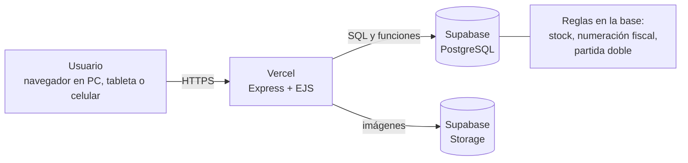

# Andeliza ERP

Sistema de gestión administrativo para pymes hondureñas. Ventas, inventario, clientes, proveedores, finanzas y facturación con CAI del SAR o facturación interna para negocios que todavía no están registrados. Todo desde el navegador.

**URL de la aplicación:** https://andeliza-qem6mfr7e-erp-0cc5.vercel.app/ 

**Token de acceso:** `LEARN-CAP-0F81B0C6`

---

## El problema

Muchas pymes hondureñas llevan sus ventas, su inventario, sus deudas y sus facturas en cuadernos, hojas sueltas o herramientas que no se hablan entre sí. El resultado es conocido, no saben con certeza cuánto ganaron en el mes, cuánto les deben ni cuánto deben ellos, el stock del sistema no coincide con el de la bodega y emitir una factura con CAI exige cuidar el rango autorizado y la fecha límite a mano.

Tener un sistema formal suele pedir comprar equipos, montar una red o un servidor, instalar programas y contar con alguien que dé soporte técnico. Para un negocio pequeño esa barrera es más grande que el problema.

## Segmento objetivo

Pymes hondureñas de comercio y servicios con uno a diez usuarios, con o sin inscripción en el SAR. Por ejemplo tiendas deportivas, ferreterías, papelerías, abarroterías y floristerías. El primer cliente es una tienda de ropa deportiva y camisetas de fútbol.

## Propuesta de valor

Una pyme hondureña puede tener un sistema contable y de ventas profesional sin comprar infraestructura de red ni servidores físicos. Todo el procesamiento y los datos viven en la nube y el usuario solo entra a la URL y empieza a trabajar.

- **Cero instalación y cero servidores.** Se abre en el navegador de cualquier computadora, tableta o celular.
- **Acceso inmediato.** No hay programas que instalar ni actualizar: cada mejora llega a todos los usuarios al mismo tiempo.
- **Doble modo de facturación.** Con un CAI configurado, cada factura usa el siguiente número del rango autorizado y el sistema se bloquea a propósito si el CAI venció o se agotó. Sin CAI, el negocio emite comprobantes internos numerados (INT-000001) para llevar un orden desde el primer día. Cuando el negocio se registra, basta con cargar el CAI (por ahora con un script SQL y, desde la Fase 7, desde la interfaz).
- **Ventas, inventario y finanzas conectados.** Una venta descuenta el stock, genera su asiento contable y, si queda a crédito, aparece sola en cuentas por cobrar con su vencimiento.
- **Contabilidad que el usuario no tiene que hacer.** Cada venta, compra, gasto, cobro y pago genera su partida doble. El dueño ve caja y bancos, lo que le deben, lo que debe y su utilidad del mes, y descarga el estado de resultados, el flujo de caja, el balance general y la antigüedad de saldos en PDF.
- **Hecho para quien no es técnico.** Formularios guiados, validaciones con mensajes claros y una interfaz que se adapta al celular.
- **Un archivo para adaptarlo a cada negocio.** Nombre, colores, módulos activos y unidades se definen en `client.config.js`.

## Qué incluye

| Fase | Módulo | Estado |
|---|---|---|
| 1 | Base: login con roles, menú, panel de inicio | Hecha |
| 2 | Categorías, clientes, proveedores e inventario con variantes, kits e imagen | Hecha |
| 3 | Punto de venta, facturación (CAI o interna), PDF, cotizaciones e historial de facturas | Hecha |
| 4 | Finanzas: partida doble, cuentas por cobrar y por pagar, ingresos, gastos, compras, libro diario y reportes en PDF | Hecha |
| 5 | Inventario visual y alertas de stock | Pendiente |
| 6 | Estadísticas de ventas | Pendiente |
| 7 | Configuración desde la interfaz, usuarios y seguridad reforzada | Pendiente |
| 8 | Acceso móvil con QR | Pendiente |

El detalle de cada pantalla, endpoint y regla de negocio está en [docs/referencia-tecnica.md](docs/referencia-tecnica.md).

## Stack técnico y por qué se eligió

| Capa | Tecnología | Por qué |
|---|---|---|
| Servidor | Node.js 20 y Express 4 | Un solo lenguaje en todo el proyecto. Express corre como función serverless, así no hay servidor propio que mantener. |
| Vistas | EJS (render en servidor) | Páginas rápidas, sin paso de compilación y fáciles de mantener por otro desarrollador. |
| Interactividad | Alpine.js | Filtros en vivo, modales y carrito sin cargar un framework pesado. |
| Estilos y gráficos | Tailwind CSS y Chart.js | Diseño consistente y gráficos de finanzas sin escribir CSS ni canvas a mano. |
| Base de datos | PostgreSQL en Supabase | Transacciones, triggers y funciones: las reglas críticas (stock, numeración fiscal, partida doble) viven en la base y se cumplen siempre. Dinero en `NUMERIC`, sin errores de redondeo. |
| Archivos | Supabase Storage | Imágenes de productos y logo sin montar un servidor de archivos. |
| Acceso a datos | `pg` (node-postgres) | Control directo de las transacciones y de las funciones de la base. |
| Sesión | `cookie-session` | La sesión viaja firmada en la cookie, algo necesario en serverless, donde no hay memoria compartida entre peticiones. |
| PDF | `pdfkit` | Facturas, cotizaciones y reportes generados en memoria, sin escribir en disco. |
| Despliegue | Vercel | HTTPS público automático y despliegue con cada `git push`. |

### Arquitectura



## Instalación

Necesitas Node.js 20, Git y una cuenta gratuita de Supabase. Para publicarlo, una cuenta de Vercel.

1. **Clonar e instalar**

   ```bash
   git clone https://github.com/DanielMorales24/Andeliza-ERP.git
   cd Andeliza-ERP
   npm install
   ```

2. **Crear la base de datos.** En un proyecto nuevo de Supabase abre *SQL Editor* y ejecuta en este orden:

   1. `db/migrations/01_schema_inicial.sql`
   2. `db/migrations/02_migracion_fase2.sql`
   3. `db/migrations/03_migracion_fase3.sql`
   4. `db/migrations/04_migracion_fase4.sql`
   5. `db/functions.sql`
   6. `db/seed.sql` *(opcional: datos de ejemplo de una tienda deportiva)*

   Más detalles en [db/README.md](db/README.md).

3. **Variables de entorno.** Copia `.env.example` a `.env` y complétalo:

   | Variable | Qué poner |
   |---|---|
   | `DATABASE_URL` | Cadena del *Transaction pooler* de Supabase (puerto 6543). |
   | `SESSION_SECRET` | Un texto largo y aleatorio. Firma la cookie de sesión. |
   | `SUPABASE_URL` | URL del proyecto, para subir imágenes. |
   | `SUPABASE_KEY` | Clave secreta de Supabase. Solo en el servidor, nunca en el navegador ni en el repositorio. |

4. **Ejecutar**

   ```bash
   npm run dev
   ```

   Abre http://localhost:3000. Con el seed puedes entrar con `admin` / `admin123` (administrador) o `vendedor` / `vendedor123`. Son usuarios de prueba: cámbialos antes de usar datos reales.

5. **Iniciar la contabilidad.** Entra a *Finanzas > Resumen* y pulsa *Iniciar contabilidad hoy*. Después usa *Saldo inicial* para cargar con cuánto dinero arrancan Caja y Bancos. Si cargaste `db/seed.sql`, la contabilidad ya viene iniciada.

6. **Publicar en Vercel.** Importa el repositorio, agrega las cuatro variables de entorno y despliega. `vercel.json` ya incluye las vistas, los archivos públicos y `pdfkit` en el paquete. Comprueba con `/salud` (base de datos) y `/salud?pdf=1` (generación de PDF).

## Estructura del repositorio

```text
andeliza-erp/
├── README.md                  Este archivo
├── docs/
│   ├── vision.md              Visión, Lean Canvas, hipótesis y alcance
│   ├── mapa-historias.md      Mapa de historias y cortes
│   ├── plan.md                Plan de 10 semanas y metodología
│   ├── modelo-datos.md        ERD y diccionario de datos
│   ├── referencia-tecnica.md  Pantallas, endpoints y reglas de negocio
│   └── bitacora/              Una bitácora por semana
├── db/
│   ├── migrations/            01 a 04: de la Fase 1 a la Fase 4
│   ├── functions.sql          Funciones y triggers (se puede repetir)
│   ├── seed.sql               Datos de ejemplo
│   └── README.md              Orden de ejecución
├── github-issues/
│   └── issues_mvp.md          Historias con criterios de aceptación
├── api/index.js               Entrada serverless de Vercel
├── app.js                     Aplicación Express
├── client.config.js           Personalización por cliente
├── controllers/  models/  routes/  services/  middlewares/  utils/
├── views/                     Plantillas EJS
├── public/                    CSS y JavaScript del navegador
└── vercel.json
```

## Documentación

- [Visión del proyecto](docs/vision.md)
- [Mapa de historias](docs/mapa-historias.md)
- [Plan de trabajo y metodología](docs/plan.md)
- [Modelo de datos](docs/modelo-datos.md)
- [Historias para GitHub Issues](github-issues/issues_mvp.md)
- [Bitácoras semanales](docs/bitacora/)

## Seguridad y límites conocidos

Andeliza ERP está en desarrollo y hay decisiones tomadas a propósito para avanzar con foco. Conviene tenerlas presentes antes de usarlo con datos reales.

- **Contraseñas en texto plano.** Es la deuda de seguridad más importante. Se corrige en la Fase 7 con hash de contraseñas.
- **Sin protección CSRF ni límite de intentos de inicio de sesión.** También planificado para la Fase 7.
- **Sin RLS en Supabase.** Solo el servidor habla con la base, con credenciales en variables de entorno. La clave secreta nunca debe llegar al navegador.
- **Tailwind se carga por CDN.** Es una decisión pragmática. Compilar el CSS para producción queda pendiente.
- **Una instancia por cliente.** No hay multi-tenant: cada negocio tiene su propia base y su propio despliegue.
- **Facturación fiscal.** El sistema controla la numeración, el rango y la fecha límite del CAI e imprime los datos requeridos, pero no está certificado ni envía facturas al SAR. El formato debe validarse con un contador.
- **Sin pruebas automatizadas dentro del repositorio.** Las baterías de prueba se corrieron durante el desarrollo y todavía no forman parte del repo.
- **Pendientes de producto.** Métodos de pago, devoluciones y notas de crédito, y crédito fiscal sobre las compras.

## Autor

Daniel Morales. Proyecto de graduación de la carrera de Ingeniería en Informática, CEUTEC Honduras.
