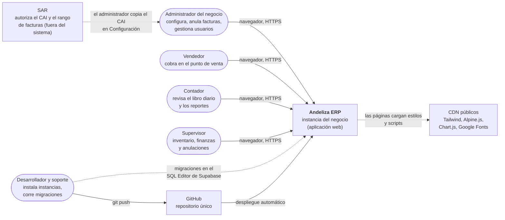
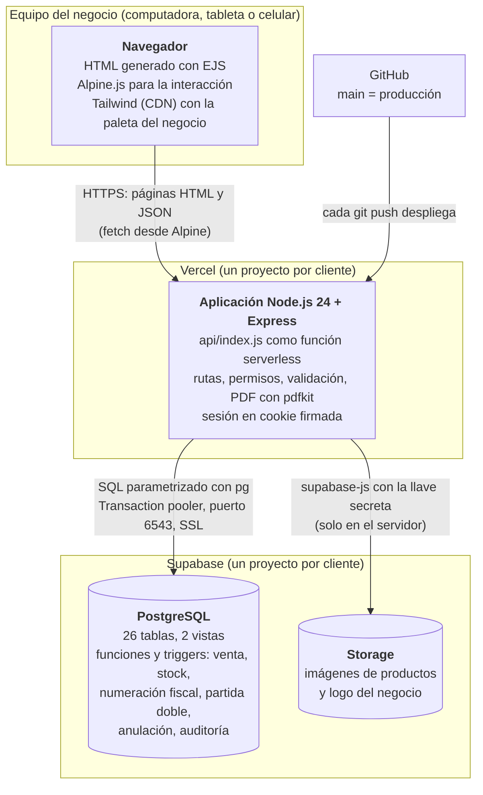
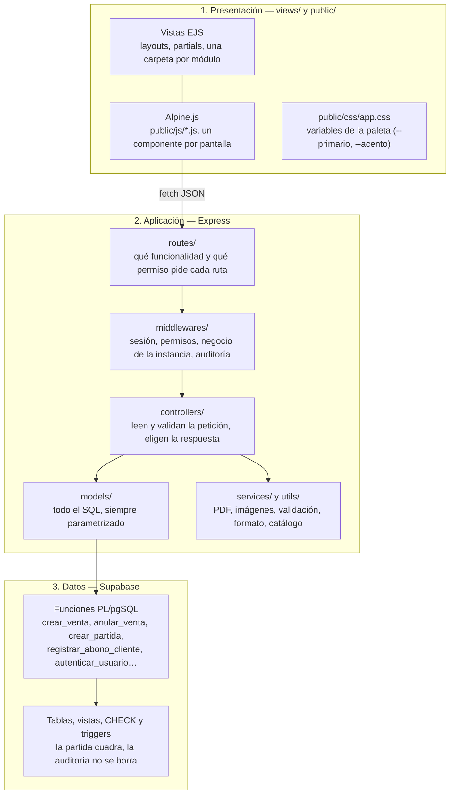
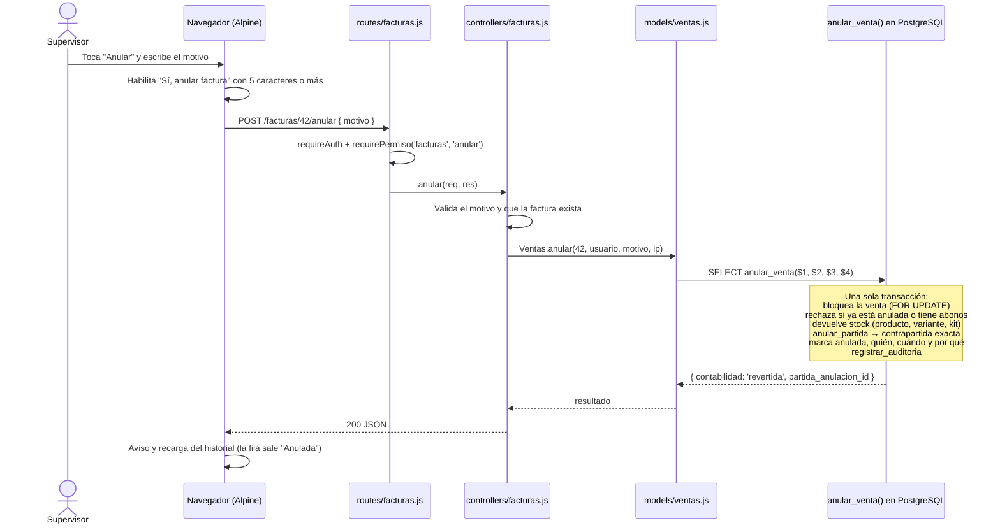

# Arquitectura de Andeliza ERP

Este documento describe cómo está construido Andeliza ERP a la semana 6: con quién se relaciona (contexto), en qué piezas se despliega (contenedores), cómo se reparten las responsabilidades entre sus tres capas y por qué el código está organizado en estas carpetas. Las decisiones que dan forma a todo esto están registradas como ADR en [`docs/decisiones/`](decisiones/).

| Documento | Para qué sirve |
|---|---|
| Este documento | La forma del sistema: piezas, capas y carpetas |
| [`docs/decisiones/`](decisiones/) | Por qué se eligió cada pieza importante (ADR) |
| [`docs/modelo-datos.md`](modelo-datos.md) | Tablas, funciones y reglas de la base |
| [`docs/permisos.md`](permisos.md) | Roles, permisos y qué pide cada ruta |
| [`docs/referencia-tecnica.md`](referencia-tecnica.md) | Detalle de cada módulo, endpoints y límites conocidos |
| [`db/README.md`](../db/README.md) | Instalar una base y actualizarla migración por migración |

## 1. Vista de contexto

Andeliza es un sistema de gestión (ventas, inventario, facturación y contabilidad por partida doble) para pequeñas empresas de Honduras. Cada negocio usa **su propia instancia**: hoy JCL Sport (tienda deportiva, comprobante interno) y Las Flores (floristería, factura con CAI del SAR), además de la instancia de desarrollo.



**Qué queda fuera del sistema.** No hay integración automática con el SAR: el CAI, su rango y su fecha límite los registra el administrador a mano y el sistema los hace cumplir (bloquea la factura si el CAI venció o se agotó). Tampoco hay pasarela de pago: el método de pago (efectivo, tarjeta, transferencia) se **registra**, no se procesa; el cobro con tarjeta ocurre en el datáfono del banco.

## 2. Vista de contenedores

Una instancia son cuatro contenedores. Todas las instancias corren **el mismo código** del mismo repositorio; lo que cambia entre ellas son las variables de entorno de Vercel y los datos de su base ([ADR 002](decisiones/002-una-instancia-por-cliente.md)).



| Contenedor | Tecnología | Responsabilidad | Lo que nunca hace |
|---|---|---|---|
| Navegador | HTML de EJS, Alpine.js, Tailwind por CDN | Mostrar, filtrar en vivo, armar el carrito, confirmar acciones | Calcular totales que se guardan, decidir permisos, hablar con la base |
| Aplicación | Node.js 24, Express 4, EJS, pdfkit, `pg`, `cookie-session` | Autenticar, autorizar cada ruta, validar entradas, llamar a la base, generar PDF | Guardar estado en memoria (cada petición puede caer en otra instancia de la función) |
| PostgreSQL | Supabase | Hacer cumplir las reglas que no pueden fallar, de forma atómica | Confiar en lo que mande el navegador (recalcula precios, valida stock y saldos) |
| Storage | Supabase | Guardar imágenes con nombre aleatorio | Exponer la llave: solo el servidor sube y borra |

**Instancias en producción.** `andeliza-dev` (desarrollo y pruebas), `andeliza-jcl-sport` y la de Las Flores. Una migración se ejecuta en cada base, primero en desarrollo y siempre antes del `git push` cuando es aditiva, como la 09 de esta semana (ver [`db/README.md`](../db/README.md)).

## 3. Las tres capas

La aplicación se organiza en tres capas con una regla simple: **cada regla vive en la capa más baja donde se puede hacer cumplir**.



### Capa de presentación (EJS y Alpine.js)

- El servidor arma cada página con EJS y le entrega sus datos en un bloque `<script type="application/json" id="datos-pagina">`. Alpine.js lee ese bloque y se encarga de lo interactivo: filtros en vivo, carrito, ventanas de confirmación. No hay paso de compilación ni framework de página única ([ADR 001](decisiones/001-stack-vercel-supabase.md)).
- La interfaz **solo muestra lo que el servidor además permitirá hacer**: el botón *Anular* aparece si el controlador manda `permisos.anular`, pero la ruta lo vuelve a exigir.
- Los colores no están escritos en las vistas: salen de la paleta del negocio como variables CSS y como colores de Tailwind (`bg-primario`, `text-acento`). Así la pantalla de acceso rediseñada en la semana 6 se adapta sola a cada cliente.

### Capa de aplicación (Express)

- **Rutas** (`routes/`): una por módulo. Cada ruta declara la funcionalidad que debe estar activa en la instancia y el permiso que exige, por ejemplo `POST /facturas/:id/anular` pide `facturas.anular`.
- **Middlewares** (`middlewares/`): `auth.js` carga la sesión y los permisos, `negocio.js` carga en cada petición el negocio de esta instancia (nombre, logo, paleta, catálogo activo) y `auditar.js` anota en la bitácora las acciones que salieron bien.
- **Controladores** (`controllers/`): leen la petición, validan con `utils/validar.js`, llaman al modelo y responden HTML o JSON. No tienen SQL.
- **Modelos** (`models/`): concentran todo el SQL. Las consultas son siempre parametrizadas (`$1, $2…`) y las operaciones con reglas de negocio llaman a una función de la base en lugar de escribir varias tablas desde Node.
- **Servicios y utilidades**: `services/pdfService.js` genera las facturas en memoria (Vercel no tiene disco), `storageService.js` sube imágenes, `utils/catalogo.js` resuelve el catálogo maestro contra lo que eligió el negocio.

### Capa de datos (Supabase)

- Lo que **no puede fallar** vive en funciones de PostgreSQL que corren en una sola transacción: descontar stock, reservar el número fiscal, generar la partida doble, cobrar sin pasarse del saldo y, desde la semana 6, anular una factura devolviendo el stock y creando la contrapartida exacta.
- Las restricciones protegen los datos aunque alguien llame a la base sin pasar por la aplicación: una partida que no cuadra no se confirma (trigger diferido), las partidas y la auditoría no se modifican ni se borran, una venta anulada exige fecha y motivo (`chk_ventas_anulacion`).
- **Nada se borra para corregir**: ingresos, gastos, abonos, partidas y ahora facturas se anulan con una contrapartida ([ADR 003](decisiones/003-anulacion-por-contrapartida.md)).

### Recorrido de una petición: anular una factura

El segundo flujo completo de la semana 6 atraviesa las tres capas así:



Si cualquier paso dentro de la función falla, no queda nada a medias: ni stock devuelto sin contrapartida ni contrapartida sin la marca de anulada.

## 4. Estructura de carpetas

```
andeliza-erp/
├── api/index.js          Punto de entrada en Vercel (exporta la app, sin listen)
├── app.js                Arma Express: sesión, vistas, estáticos, rutas y manejo de errores
├── client.config.js      Catálogo maestro: lo que EXISTE (paletas, unidades, métodos de pago…)
├── modulos.js            Módulos del menú, su permiso y la pantalla de inicio de cada rol
├── db.js                 Pool de pg, conversión de tipos y transacciones
├── routes/               Una ruta por módulo: funcionalidad + permiso de cada endpoint
├── middlewares/          Sesión y permisos, negocio de la instancia, auditoría
├── controllers/          Leen y validan la petición; responden HTML o JSON
├── models/               Todo el SQL (parametrizado) y las llamadas a funciones de la base
├── services/             PDF de facturas y reportes, imágenes en Supabase Storage
├── utils/                Validación, formato regional, catálogo, colores, totales
├── views/                EJS: layouts, partials y una carpeta por módulo
├── public/               css/app.css, js/ (un componente de Alpine por pantalla), img/
├── db/                   migrations/ 01 a 09, functions.sql, seeds y su README
├── docs/                 Visión, plan, arquitectura, ADR, modelo de datos, bitácoras
└── vercel.json           Empaqueta views/, public/, client.config.js y las fuentes de pdfkit
```

| Carpeta | Por qué existe y por qué así |
|---|---|
| `routes/`, `controllers/`, `models/` | Separan **quién puede** (ruta), **qué se pidió** (controlador) y **cómo se guarda** (modelo). Un cambio de permiso no toca SQL y un cambio de consulta no toca permisos. Hay un archivo por módulo en cada carpeta: el historial de facturas está en `routes/facturas.js` y `controllers/facturas.js`, y su SQL en `models/ventas.js`, porque una factura es una venta. |
| `middlewares/` | Lo que se repite en todas las peticiones (sesión, permisos, negocio de la instancia, auditoría) se escribe una sola vez y se declara en la ruta, donde se ve. |
| `services/` | Lo que habla con algo distinto de la base (pdfkit, Supabase Storage). Se puede cambiar el proveedor sin tocar los controladores. |
| `utils/` | Funciones puras y sin estado, fáciles de probar sin servidor ni base: validación, formato de dinero y fechas, cálculo de totales en centavos, contraste de colores. |
| `views/` y `public/js/` | Una carpeta de vistas y un archivo de Alpine por pantalla. Sin compilación: lo que está en el repositorio es lo que llega al navegador. |
| `client.config.js` | El **catálogo maestro** compartido por todas las instancias: dice qué opciones existen. Lo que cada negocio eligió vive en su base ([decisión D-08](plan.md)). Por eso el archivo no contiene ningún dato de un cliente. |
| `db/` | El esquema versionado: migraciones numeradas que solo se agregan, nunca se editan, y `functions.sql` con todas las funciones (`CREATE OR REPLACE`). Una base nueva se instala con la cadena completa; una en uso recibe solo las migraciones que le faltan. |
| `api/` y `vercel.json` | Lo único propio de Vercel. Si el despliegue cambiara de plataforma, `app.js` sigue igual. |
| `docs/` | Lo que un evaluador o un desarrollador nuevo necesita para entender el sistema sin leer el código. |

**Dónde se toca cada cosa en la semana 6.** El método de pago y la anulación no necesitaron archivos nuevos: entraron en los módulos que ya existían (`pos`, `facturas`, `ventas`, `documentos`, `finanzas`) y en la migración `db/migrations/09_migracion_semana6.sql`. Que un flujo nuevo quepa en la estructura sin forzarla es la señal de que la organización por módulos y capas funciona.

## 5. Atributos de calidad

| Atributo | Cómo lo atiende la arquitectura |
|---|---|
| Consistencia contable | La partida se genera dentro de la misma transacción que la venta, el cobro o la anulación. Un trigger diferido impide confirmar una partida que no cuadra. |
| Trazabilidad | Nada se borra para corregir; cada anulación queda ligada a su original (`reversa_de`) y la auditoría no se puede modificar. |
| Seguridad | Permisos por ruta en el servidor, contraseñas con bcrypt en la base, bloqueo por intentos, sesión en cookie firmada `HttpOnly`, SQL parametrizado y la llave de Storage solo en el servidor. |
| Aislamiento entre clientes | Una base por cliente: un error de consulta no puede mostrar datos de otro negocio ([ADR 002](decisiones/002-una-instancia-por-cliente.md)). |
| Despliegue sin interrupciones | Las migraciones aditivas se ejecutan antes del `git push` y el código anterior sigue funcionando con ellas; *Instant Rollback* de Vercel queda disponible. |
| Mantenibilidad | Capas con responsabilidades claras, un archivo por módulo, nombres en español y documentación de cada decisión. |

## 6. Límites conocidos de la arquitectura

- **Tailwind y Alpine se cargan desde un CDN.** Si el CDN no responde, la página carga sin estilos. Está planeado compilar el CSS en la semana 9 ([plan](plan.md)).
- **Sin protección CSRF con token.** La cookie `SameSite=Lax` cubre los casos comunes; el token sigue pendiente ([permisos](permisos.md)).
- **Una migración por cada base.** Con más clientes, aplicar la misma migración en cada Supabase a mano se vuelve lento y propenso a olvidos; haría falta un script que las aplique a todas.
- **La anulación es total.** No hay devoluciones parciales ni notas de crédito fiscales ([ADR 003](decisiones/003-anulacion-por-contrapartida.md)).
