# Modelo de datos

Modelo relacional de Andeliza ERP en PostgreSQL (Supabase). Cubre las Fases 1 a 4: acceso y configuración, catálogo e inventario, clientes y proveedores, ventas y facturación, compras, cartera y contabilidad por partida doble.

> Este documento se generó leyendo el catálogo de una base real creada con `db/migrations/01` a `04`, `db/functions.sql` y `db/seed.sql`, así que coincide con los scripts. La base tiene **22 tablas**, **2 vistas**, **208 columnas** y **33 claves foráneas**.

## Decisiones de modelado

- **Todo en español**, con `snake_case` sin ñ ni acentos. Facilita el soporte y el traspaso a otros desarrolladores locales.
- **Una instancia por cliente.** No hay `negocio_id` ni multi-tenant: cada negocio tiene su propia base en Supabase. Por eso `configuracion_negocio` tiene una sola fila (`id = 1`).
- **Dinero en `NUMERIC(18,2)`**, nunca en decimales flotantes. Las cantidades usan `NUMERIC` para admitir kilos y metros.
- **Se desactiva, no se borra.** Los catálogos usan `activo` para conservar el historial. Las claves foráneas de los documentos financieros usan `NO ACTION` para que no se pueda borrar algo que ya tiene movimientos.
- **Facturación dual.** `ventas.tipo_documento` es `fiscal` (número con CAI desde `configuracion_fiscal`) o `interno` (INT-000001, cuando no hay CAI activo).
- **Variantes y kits.** Un producto con variantes guarda su stock en `variantes_producto` (su `stock` propio queda en 0). Un kit (`es_compuesto`) descuenta el stock de sus `componentes_producto`.
- **Costo congelado.** `detalle_venta.costo_unitario` guarda el costo al momento de vender, de ahí sale el costo de ventas aunque el costo del producto cambie después.
- **Cobros que no se duplican.** `ventas.clave_cliente` es única cuando existe: reintentar un cobro devuelve la misma venta.
- **Libro diario inmutable.** `partidas` y `partida_lineas` no se editan ni se borran (triggers). Un error se corrige con una contrapartida enlazada por `partidas.reversa_de`.
- **Referencias a varias tablas.** `partidas.origen_tipo` y `origen_id` apuntan al documento que generó la partida y `abonos_clientes` y `pagos_proveedores` se enlazan a una de dos tablas con un `CHECK` de "exactamente uno". Por eso esas referencias no llevan FK.

## Diagrama entidad-relación

```mermaid
erDiagram
    usuarios {
        bigint id PK
        varchar nombre
        varchar usuario UK
        varchar rol
    }
    configuracion_negocio {
        int id PK
        varchar nombre
    }
    configuracion_fiscal {
        bigint id PK
        varchar cai
    }
    codigos_temporales {
        bigint id PK
        varchar codigo
    }
    auditoria {
        bigint id PK
    }
    categorias {
        bigint id PK
        varchar nombre UK
    }
    productos {
        bigint id PK
        varchar sku UK
        varchar nombre
        bigint categoria_id FK
        bigint proveedor_id FK
        numeric precio_venta
        numeric stock
    }
    variantes_producto {
        bigint id PK
        bigint producto_id FK
        varchar sku UK
        numeric stock
    }
    componentes_producto {
        bigint id PK
        bigint producto_padre_id FK
        bigint producto_hijo_id FK
        numeric cantidad
    }
    clientes {
        bigint id PK
        varchar nombre
        varchar tipo
    }
    proveedores {
        bigint id PK
        varchar nombre
        varchar tipo
    }
    ventas {
        bigint id PK
        bigint cliente_id FK
        bigint usuario_id FK
        numeric total
        varchar estado
        varchar numero_factura UK
        varchar tipo_documento
    }
    detalle_venta {
        bigint id PK
        bigint venta_id FK
        bigint producto_id FK
        bigint variante_id FK
        numeric cantidad
    }
    compras {
        bigint id PK
        bigint proveedor_id FK
        numeric total
        date fecha
        varchar estado_pago
        bigint cuenta_id FK
        bigint partida_id FK
    }
    detalle_compra {
        bigint id PK
        bigint compra_id FK
        bigint producto_id FK
        bigint variante_id FK
        numeric cantidad
    }
    ingresos {
        bigint id PK
        varchar tipo
        numeric monto
        date fecha
        varchar estado_cobro
        bigint cliente_id FK
        bigint cuenta_id FK
        bigint partida_id FK
    }
    gastos {
        bigint id PK
        varchar categoria
        numeric monto
        date fecha
        varchar estado_pago
        bigint proveedor_id FK
        bigint cuenta_id FK
        bigint partida_id FK
    }
    abonos_clientes {
        bigint id PK
        bigint venta_id FK
        bigint ingreso_id FK
        numeric monto
        date fecha
        bigint cuenta_id FK
        bigint partida_id FK
    }
    pagos_proveedores {
        bigint id PK
        bigint compra_id FK
        bigint gasto_id FK
        numeric monto
        date fecha
        bigint cuenta_id FK
        bigint partida_id FK
    }
    plan_cuentas {
        bigint id PK
        varchar codigo UK
        varchar clave UK
        varchar nombre
        varchar tipo
        boolean es_efectivo
    }
    partidas {
        bigint id PK
        varchar numero UK
        date fecha
        varchar origen_tipo
        bigint reversa_de FK
    }
    partida_lineas {
        bigint id PK
        bigint partida_id FK
        bigint cuenta_id FK
        numeric debe
        numeric haber
    }
    categorias |o--o{ productos : "categoria_id"
    proveedores |o--o{ productos : "proveedor_id"
    productos ||--o{ variantes_producto : "producto_id"
    productos ||--o{ componentes_producto : "producto_hijo_id"
    productos ||--o{ componentes_producto : "producto_padre_id"
    clientes |o--o{ ventas : "cliente_id"
    usuarios |o--o{ ventas : "usuario_id"
    productos ||--o{ detalle_venta : "producto_id"
    variantes_producto |o--o{ detalle_venta : "variante_id"
    ventas ||--o{ detalle_venta : "venta_id"
    plan_cuentas |o--o{ compras : "cuenta_id"
    partidas |o--o{ compras : "partida_id"
    proveedores |o--o{ compras : "proveedor_id"
    compras ||--o{ detalle_compra : "compra_id"
    productos ||--o{ detalle_compra : "producto_id"
    variantes_producto |o--o{ detalle_compra : "variante_id"
    clientes |o--o{ ingresos : "cliente_id"
    plan_cuentas |o--o{ ingresos : "cuenta_id"
    partidas |o--o{ ingresos : "partida_id"
    plan_cuentas |o--o{ gastos : "cuenta_id"
    partidas |o--o{ gastos : "partida_id"
    proveedores |o--o{ gastos : "proveedor_id"
    plan_cuentas ||--o{ abonos_clientes : "cuenta_id"
    ingresos |o--o{ abonos_clientes : "ingreso_id"
    partidas |o--o{ abonos_clientes : "partida_id"
    ventas |o--o{ abonos_clientes : "venta_id"
    compras |o--o{ pagos_proveedores : "compra_id"
    plan_cuentas ||--o{ pagos_proveedores : "cuenta_id"
    gastos |o--o{ pagos_proveedores : "gasto_id"
    partidas |o--o{ pagos_proveedores : "partida_id"
    partidas |o--o| partidas : "reversa_de"
    plan_cuentas ||--o{ partida_lineas : "cuenta_id"
    partidas ||--o{ partida_lineas : "partida_id"
```

Lectura: `||` indica "exactamente uno", `|o` "cero o uno" (la clave foránea admite NULL) y `o{` "cero o muchos".

### Por dominio

| Dominio | Tablas |
|---|---|
| Acceso y configuración | `usuarios`, `configuracion_negocio`, `configuracion_fiscal`, `codigos_temporales`, `auditoria` |
| Catálogo e inventario | `categorias`, `productos`, `variantes_producto`, `componentes_producto` |
| Terceros | `clientes`, `proveedores` |
| Ventas y facturación | `ventas`, `detalle_venta` |
| Compras | `compras`, `detalle_compra` |
| Ingresos, gastos y cartera | `ingresos`, `gastos`, `abonos_clientes`, `pagos_proveedores` |
| Contabilidad (partida doble) | `plan_cuentas`, `partidas`, `partida_lineas` |

## Resumen del diccionario

| Tabla | PK | FK → destino (ON DELETE) | Restricciones | Propósito |
|---|---|---|---|---|
| `usuarios` | `id` | — | UNIQUE `usuario` CHECK `(rol IN ('admin', 'vendedor'))` | Cuentas de acceso. Cada una tiene un rol (administrador o vendedor). |
| `configuracion_negocio` | `id` | — | CHECK `(id = 1)` | Datos del negocio y contadores internos. Tabla de una sola fila. |
| `configuracion_fiscal` | `id` | — | UNIQUE `activo (solo donde activo)` CHECK `((numero_actual >= (rango_inicio - 1)) AND (numero_actual <= rango_fin))` CHECK `(rango_fin >= rango_inicio)` | CAI del SAR con su rango autorizado, fecha límite y tasa de impuesto. |
| `codigos_temporales` | `id` | — | — | Códigos temporales de un solo uso con vencimiento, previstos para el acceso móvil con QR (Fase 8). |
| `auditoria` | `id` | — | — | Bitácora de acciones críticas (por ejemplo, cada venta creada). |
| `categorias` | `id` | — | UNIQUE `nombre` | Agrupan los productos. |
| `productos` | `id` | `categoria_id` → `categorias` (SET NULL) `proveedor_id` → `proveedores` (SET NULL) | UNIQUE `sku` | Catálogo: precios, costo, stock, unidad y kits. |
| `variantes_producto` | `id` | `producto_id` → `productos` (CASCADE) | UNIQUE `producto_id,nombre_variante` UNIQUE `sku` | Variantes de un producto (talla, equipo) con stock propio. |
| `componentes_producto` | `id` | `producto_hijo_id` → `productos` (RESTRICT) `producto_padre_id` → `productos` (CASCADE) | UNIQUE `producto_padre_id,producto_hijo_id` CHECK `(cantidad > 0)` CHECK `(producto_padre_id <> producto_hijo_id)` | Composición de un kit: qué productos lo forman y en qué cantidad. |
| `clientes` | `id` | — | — | Personas o empresas a las que se vende. El RTN es opcional. |
| `proveedores` | `id` | — | — | Personas o empresas a las que se compra. |
| `ventas` | `id` | `cliente_id` → `clientes` (SET NULL) `usuario_id` → `usuarios` (NO ACTION) | UNIQUE `numero_factura` UNIQUE `clave_cliente (solo donde clave_cliente IS NOT NULL)` CHECK `(estado IN ('P', 'C'))` CHECK `(tipo_documento IN ('fiscal', 'interno'))` | Encabezado de cada venta: factura fiscal o comprobante interno, estado de pago y vencimiento. |
| `detalle_venta` | `id` | `producto_id` → `productos` (RESTRICT) `variante_id` → `variantes_producto` (SET NULL) `venta_id` → `ventas` (CASCADE) | CHECK `(cantidad > 0)` | Líneas de cada venta con el precio y el costo vigentes al vender. |
| `compras` | `id` | `cuenta_id` → `plan_cuentas` (NO ACTION) `partida_id` → `partidas` (NO ACTION) `proveedor_id` → `proveedores` (NO ACTION) | CHECK `(estado_pago IN ('P', 'C'))` | Compras de inventario a proveedores, con su condición de pago. |
| `detalle_compra` | `id` | `compra_id` → `compras` (CASCADE) `producto_id` → `productos` (RESTRICT) `variante_id` → `variantes_producto` (SET NULL) | CHECK `(cantidad > 0)` | Líneas de cada compra. |
| `ingresos` | `id` | `cliente_id` → `clientes` (NO ACTION) `cuenta_id` → `plan_cuentas` (NO ACTION) `partida_id` → `partidas` (NO ACTION) | CHECK `(estado_cobro IN ('P', 'C'))` CHECK `(monto >= 0)` | Ingresos varios (intereses, alquileres, servicios...) cobrados o por cobrar. |
| `gastos` | `id` | `cuenta_id` → `plan_cuentas` (NO ACTION) `partida_id` → `partidas` (NO ACTION) `proveedor_id` → `proveedores` (NO ACTION) | CHECK `(estado_pago IN ('P', 'C'))` CHECK `(monto >= 0)` | Gastos del negocio, pagados o por pagar. |
| `abonos_clientes` | `id` | `cuenta_id` → `plan_cuentas` (NO ACTION) `ingreso_id` → `ingresos` (NO ACTION) `partida_id` → `partidas` (NO ACTION) `venta_id` → `ventas` (NO ACTION) | CHECK `(monto > 0)` CHECK `exactamente uno de venta_id o ingreso_id (no nulo)` | Cobros parciales o totales de ventas a crédito o ingresos por cobrar. |
| `pagos_proveedores` | `id` | `compra_id` → `compras` (NO ACTION) `cuenta_id` → `plan_cuentas` (NO ACTION) `gasto_id` → `gastos` (NO ACTION) `partida_id` → `partidas` (NO ACTION) | CHECK `exactamente uno de compra_id o gasto_id (no nulo)` CHECK `(monto > 0)` | Pagos parciales o totales de compras o gastos por pagar. |
| `plan_cuentas` | `id` | — | UNIQUE `clave` UNIQUE `codigo` CHECK `(tipo IN ('activo', 'pasivo', 'patrimonio', 'ingreso', 'gasto'))` | Catálogo de cuentas contables: activo, pasivo, patrimonio, ingreso y gasto. |
| `partidas` | `id` | `reversa_de` → `partidas` (NO ACTION) | UNIQUE `numero` UNIQUE `reversa_de (solo donde reversa_de IS NOT NULL)` | Libro diario: una partida (asiento) por operación. No se modifican ni se borran. |
| `partida_lineas` | `id` | `cuenta_id` → `plan_cuentas` (NO ACTION) `partida_id` → `partidas` (NO ACTION) | CHECK `((debe >= 0) AND (haber >= 0) AND ((debe > 0) <> (haber > 0)))` | Líneas Debe y Haber de cada partida. Cada partida cuadra. |

### Cómo se elige el ON DELETE

| Regla | Dónde se usa | Por qué |
|---|---|---|
| `CASCADE` | `detalle_venta`, `detalle_compra`, `variantes_producto` y `componentes_producto` (lado del kit) | Las líneas y variantes no existen sin su documento o producto. |
| `RESTRICT` | `detalle_venta`, `detalle_compra` y `componentes_producto` hacia `productos` | No se puede borrar un producto que ya se vendió, se compró o forma parte de un kit. |
| `SET NULL` | `productos` → categoría y proveedor, `ventas` → cliente, `detalle_*` → variante | Borrar un dato de catálogo no debe borrar el documento. La venta queda como Consumidor Final. |
| `NO ACTION` | Tablas financieras y contables | Nada con movimientos se borra: se anula con una contrapartida. |

Las columnas `usuario_id` de las tablas financieras y de `auditoria` no tienen FK: son una referencia lógica a `usuarios.id`. Los usuarios se desactivan, no se borran, así que la referencia no queda huérfana. Agregar la FK es una mejora pendiente.

## Diccionario detallado

### `usuarios`

Cuentas de acceso. Cada una tiene un rol (administrador o vendedor).

| Columna | Tipo | Nulo | Por defecto | Restricciones | Descripción |
|---|---|---|---|---|---|
| `id` | `bigint` | No | `nextval('usuarios_id_seq'::regclass)` | PK | Identificador. |
| `nombre` | `varchar(150)` | No | — | — | Nombre completo. |
| `usuario` | `varchar(60)` | No | — | UNIQUE | Nombre de usuario para iniciar sesión (único, sin distinguir mayúsculas). |
| `contrasena` | `varchar(255)` | No | — | — | Contraseña. Se guarda en texto plano por ahora: deuda de seguridad conocida, se corrige en la Fase 7. |
| `rol` | `varchar(10)` | No | `'vendedor'` | — | admin o vendedor. |
| `activo` | `boolean` | No | `true` | — | TRUE si está en uso. Se desactiva en lugar de borrar. |
| `creado_en` | `timestamptz` | No | `now()` | — | Fecha y hora de creación. |

Restricciones de la tabla: CHECK `(rol IN ('admin', 'vendedor'))`.

### `configuracion_negocio`

Datos del negocio y contadores internos. Tabla de una sola fila.

| Columna | Tipo | Nulo | Por defecto | Restricciones | Descripción |
|---|---|---|---|---|---|
| `id` | `int` | No | `1` | PK | Siempre 1: la tabla tiene una sola fila. |
| `nombre` | `varchar(150)` | No | `'Mi Negocio'` | — | Nombre comercial del negocio. |
| `logo_url` | `text` | Sí | — | — | Logo para el menú y los PDF. |
| `rtn` | `varchar(20)` | Sí | — | — | Registro Tributario Nacional (opcional: no todas las pymes están inscritas). |
| `direccion` | `text` | Sí | — | — | Dirección. |
| `telefono` | `varchar(30)` | Sí | — | — | Teléfono de contacto. |
| `correo` | `varchar(150)` | Sí | — | — | Correo electrónico. |
| `prefijo_factura_interna` | `varchar(10)` | No | `'INT'` | — | Prefijo de los comprobantes internos (INT). |
| `numero_factura_interna` | `int` | No | `0` | — | Último número interno usado. |
| `zona_horaria` | `varchar(60)` | No | `'America/Tegucigalpa'` | — | Zona horaria del negocio: define qué día es hoy y a qué día pertenece cada venta. |
| `dias_credito` | `int` | No | `30` | — | Plazo de crédito que se supone cuando una deuda no trae vencimiento (30 por defecto). |
| `contabilidad_inicio` | `date` | Sí | — | — | Día en que arrancó la contabilidad. NULL = todavía no se inició. |
| `numero_partida_actual` | `int` | No | `0` | — | Último número de partida usado (correlativo sin saltos). |

Restricciones de la tabla: CHECK `(id = 1)`.

### `configuracion_fiscal`

CAI del SAR con su rango autorizado, fecha límite y tasa de impuesto.

| Columna | Tipo | Nulo | Por defecto | Restricciones | Descripción |
|---|---|---|---|---|---|
| `id` | `bigint` | No | `nextval('configuracion_fiscal_id_seq'::regclass)` | PK | Identificador. |
| `cai` | `varchar(100)` | No | — | — | Clave de Autorización de Impresión asignada por el SAR. |
| `rango_inicio` | `int` | No | — | — | Primer número autorizado. |
| `rango_fin` | `int` | No | — | — | Último número autorizado. |
| `numero_actual` | `int` | No | — | — | Último número usado (arranca en rango_inicio - 1). |
| `fecha_limite` | `date` | No | — | — | Fecha límite de emisión autorizada. Vencida, la facturación fiscal se bloquea. |
| `tasa_impuesto` | `numeric(5,4)` | No | `0.1500` | — | Tasa de impuesto en decimal (0.1500 = 15 %). |
| `moneda` | `varchar(10)` | No | `'L'` | — | Símbolo de la moneda (L). |
| `pie_legal` | `text` | Sí | — | — | Texto legal al pie de la factura. |
| `activo` | `boolean` | No | `true` | — | TRUE para la configuración vigente. |

Restricciones de la tabla: UNIQUE `activo (solo donde activo)`. CHECK `((numero_actual >= (rango_inicio - 1)) AND (numero_actual <= rango_fin))`. CHECK `(rango_fin >= rango_inicio)`.

El índice único parcial sobre `activo` garantiza que solo exista **una** configuración fiscal activa a la vez.

### `codigos_temporales`

Códigos temporales de un solo uso con vencimiento, previstos para el acceso móvil con QR (Fase 8).

| Columna | Tipo | Nulo | Por defecto | Restricciones | Descripción |
|---|---|---|---|---|---|
| `id` | `bigint` | No | `nextval('codigos_temporales_id_seq'::regclass)` | PK | Identificador. |
| `codigo` | `varchar(6)` | No | — | — | Código temporal de acceso. |
| `expira_en` | `timestamptz` | No | — | — | Fecha y hora en que vence el código. |
| `usado` | `boolean` | No | `false` | — | TRUE cuando el código ya se utilizó. |

### `auditoria`

Bitácora de acciones críticas (por ejemplo, cada venta creada).

| Columna | Tipo | Nulo | Por defecto | Restricciones | Descripción |
|---|---|---|---|---|---|
| `id` | `bigint` | No | `nextval('auditoria_id_seq'::regclass)` | PK | Identificador. |
| `usuario_id` | `bigint` | Sí | — | — | Usuario que hizo la acción (sin FK declarada). |
| `accion` | `varchar(50)` | No | — | — | Acción registrada, por ejemplo crear_venta. |
| `entidad` | `varchar(50)` | Sí | — | — | Entidad afectada. |
| `entidad_id` | `bigint` | Sí | — | — | Id del registro afectado. |
| `detalles` | `jsonb` | Sí | — | — | Datos adicionales en JSON. |
| `creado_en` | `timestamptz` | No | `now()` | — | Fecha y hora de creación. |

### `categorias`

Agrupan los productos.

| Columna | Tipo | Nulo | Por defecto | Restricciones | Descripción |
|---|---|---|---|---|---|
| `id` | `bigint` | No | `nextval('categorias_id_seq'::regclass)` | PK | Identificador. |
| `nombre` | `varchar(100)` | No | — | UNIQUE | Nombre de la categoría. |
| `descripcion` | `text` | Sí | — | — | Descripción. |
| `activo` | `boolean` | No | `true` | — | TRUE si está en uso. Se desactiva en lugar de borrar. |

### `productos`

Catálogo: precios, costo, stock, unidad y kits.

| Columna | Tipo | Nulo | Por defecto | Restricciones | Descripción |
|---|---|---|---|---|---|
| `id` | `bigint` | No | `nextval('productos_id_seq'::regclass)` | PK | Identificador. |
| `sku` | `varchar(50)` | Sí | — | UNIQUE | Código único del producto. |
| `nombre` | `varchar(200)` | No | — | — | Nombre del producto. |
| `categoria_id` | `bigint` | Sí | — | FK → categorias(id), ON DELETE SET NULL | Categoría (opcional). |
| `proveedor_id` | `bigint` | Sí | — | FK → proveedores(id), ON DELETE SET NULL | Proveedor habitual (opcional). |
| `precio_compra` | `numeric(18,2)` | No | `0` | — | Costo del producto. Desde la Fase 4 se recalcula con promedio ponderado en cada compra. |
| `precio_venta` | `numeric(18,2)` | No | `0` | — | Precio de venta sin impuesto. |
| `unidad` | `varchar(20)` | No | `'unidad'` | — | unidad, par, paquete, kilo, metro... |
| `stock` | `numeric(12,2)` | No | `0` | — | Existencias. Es 0 cuando el producto maneja variantes: entonces el stock vive en variantes_producto. |
| `stock_minimo` | `numeric(12,2)` | No | `0` | — | Nivel mínimo: por debajo se considera stock bajo. |
| `descripcion` | `text` | Sí | — | — | Descripción. |
| `imagen_url` | `text` | Sí | — | — | Imagen principal, guardada en Supabase Storage. |
| `es_compuesto` | `boolean` | No | `false` | — | TRUE si es un kit (se descuenta el stock de sus componentes). |
| `activo` | `boolean` | No | `true` | — | TRUE si está en uso. Se desactiva en lugar de borrar. |
| `creado_en` | `timestamptz` | No | `now()` | — | Fecha y hora de creación. |

### `variantes_producto`

Variantes de un producto (talla, equipo) con stock propio.

| Columna | Tipo | Nulo | Por defecto | Restricciones | Descripción |
|---|---|---|---|---|---|
| `id` | `bigint` | No | `nextval('variantes_producto_id_seq'::regclass)` | PK | Identificador. |
| `producto_id` | `bigint` | No | — | FK → productos(id), ON DELETE CASCADE | Producto al que pertenece. |
| `sku` | `varchar(50)` | Sí | — | UNIQUE | Código único del producto. |
| `nombre_variante` | `varchar(100)` | No | — | — | Texto visible, por ejemplo «M / Local». |
| `atributos` | `jsonb` | Sí | — | — | Atributos en JSON (talla, equipo). |
| `stock` | `numeric(12,2)` | No | `0` | — | Existencias (admite decimales: kilo, metro...). |
| `stock_minimo` | `numeric(12,2)` | No | `0` | — | Nivel mínimo: por debajo se considera stock bajo. |
| `activo` | `boolean` | No | `true` | — | TRUE si está en uso. Se desactiva en lugar de borrar. |

Restricciones de la tabla: UNIQUE `producto_id,nombre_variante`.

### `componentes_producto`

Composición de un kit: qué productos lo forman y en qué cantidad.

| Columna | Tipo | Nulo | Por defecto | Restricciones | Descripción |
|---|---|---|---|---|---|
| `id` | `bigint` | No | `nextval('componentes_producto_id_seq'::regclass)` | PK | Identificador. |
| `producto_padre_id` | `bigint` | No | — | FK → productos(id), ON DELETE CASCADE | Kit (producto compuesto). |
| `producto_hijo_id` | `bigint` | No | — | FK → productos(id), ON DELETE RESTRICT | Producto que forma parte del kit. |
| `cantidad` | `numeric(12,2)` | No | — | — | Unidades del componente por cada kit. |

Restricciones de la tabla: UNIQUE `producto_padre_id,producto_hijo_id`. CHECK `(cantidad > 0)`. CHECK `(producto_padre_id <> producto_hijo_id)`.

### `clientes`

Personas o empresas a las que se vende. El RTN es opcional.

| Columna | Tipo | Nulo | Por defecto | Restricciones | Descripción |
|---|---|---|---|---|---|
| `id` | `bigint` | No | `nextval('clientes_id_seq'::regclass)` | PK | Identificador. |
| `nombre` | `varchar(150)` | No | — | — | Nombre o razón social. |
| `tipo` | `varchar(20)` | No | `'natural'` | — | natural o empresa. |
| `rtn` | `varchar(20)` | Sí | — | — | Registro Tributario Nacional (opcional: no todas las pymes están inscritas). |
| `telefono` | `varchar(30)` | Sí | — | — | Teléfono de contacto. |
| `correo` | `varchar(150)` | Sí | — | — | Correo electrónico. |
| `direccion` | `text` | Sí | — | — | Dirección. |
| `notas` | `text` | Sí | — | — | Notas del cliente. |
| `activo` | `boolean` | No | `true` | — | TRUE si está en uso. Se desactiva en lugar de borrar. |
| `creado_en` | `timestamptz` | No | `now()` | — | Fecha y hora de creación. |

### `proveedores`

Personas o empresas a las que se compra.

| Columna | Tipo | Nulo | Por defecto | Restricciones | Descripción |
|---|---|---|---|---|---|
| `id` | `bigint` | No | `nextval('proveedores_id_seq'::regclass)` | PK | Identificador. |
| `nombre` | `varchar(150)` | No | — | — | Nombre o razón social. |
| `tipo` | `varchar(20)` | No | `'empresa'` | — | natural o empresa. |
| `rtn` | `varchar(20)` | Sí | — | — | Registro Tributario Nacional (opcional: no todas las pymes están inscritas). |
| `contacto` | `varchar(150)` | Sí | — | — | Persona de contacto. |
| `telefono` | `varchar(30)` | Sí | — | — | Teléfono de contacto. |
| `correo` | `varchar(150)` | Sí | — | — | Correo electrónico. |
| `direccion` | `text` | Sí | — | — | Dirección. |
| `notas` | `text` | Sí | — | — | Notas libres. |
| `activo` | `boolean` | No | `true` | — | TRUE si está en uso. Se desactiva en lugar de borrar. |
| `creado_en` | `timestamptz` | No | `now()` | — | Fecha y hora de creación. |

### `ventas`

Encabezado de cada venta: factura fiscal o comprobante interno, estado de pago y vencimiento.

| Columna | Tipo | Nulo | Por defecto | Restricciones | Descripción |
|---|---|---|---|---|---|
| `id` | `bigint` | No | `nextval('ventas_id_seq'::regclass)` | PK | Identificador. |
| `cliente_id` | `bigint` | Sí | — | FK → clientes(id), ON DELETE SET NULL | Cliente. NULL = Consumidor Final. |
| `usuario_id` | `bigint` | Sí | — | FK → usuarios(id), ON DELETE NO ACTION | Vendedor que cobró. |
| `subtotal` | `numeric(18,2)` | No | `0` | — | Suma de las líneas, sin impuesto. |
| `impuesto` | `numeric(18,2)` | No | `0` | — | Impuesto de la venta. |
| `total` | `numeric(18,2)` | No | `0` | — | Subtotal más impuesto. |
| `estado` | `varchar(1)` | No | `'P'` | — | P = pendiente de pago, C = pagada. |
| `numero_factura` | `varchar(80)` | Sí | — | UNIQUE | Número fiscal con CAI o número interno (INT-000001). Único. |
| `creado_en` | `timestamptz` | No | `now()` | — | Fecha y hora de creación. |
| `tipo_documento` | `varchar(10)` | No | `'fiscal'` | — | fiscal (con CAI) o interno. |
| `clave_cliente` | `varchar(64)` | Sí | — | — | Clave que genera el navegador: si un cobro se reintenta, no se duplica la venta. |
| `fecha_vencimiento` | `date` | Sí | — | — | Vencimiento cuando la venta quedó a crédito. |

Restricciones de la tabla: UNIQUE `clave_cliente (solo donde clave_cliente IS NOT NULL)`. CHECK `(estado IN ('P', 'C'))`. CHECK `(tipo_documento IN ('fiscal', 'interno'))`.

### `detalle_venta`

Líneas de cada venta con el precio y el costo vigentes al vender.

| Columna | Tipo | Nulo | Por defecto | Restricciones | Descripción |
|---|---|---|---|---|---|
| `id` | `bigint` | No | `nextval('detalle_venta_id_seq'::regclass)` | PK | Identificador. |
| `venta_id` | `bigint` | No | — | FK → ventas(id), ON DELETE CASCADE | Venta a la que pertenece. |
| `producto_id` | `bigint` | No | — | FK → productos(id), ON DELETE RESTRICT | Producto vendido. |
| `variante_id` | `bigint` | Sí | — | FK → variantes_producto(id), ON DELETE SET NULL | Variante vendida (opcional). |
| `cantidad` | `numeric(12,2)` | No | — | — | Cantidad (admite decimales). |
| `precio_unitario` | `numeric(18,2)` | No | — | — | Precio de venta al momento de vender. |
| `costo_unitario` | `numeric(18,2)` | No | `0` | — | Costo al momento de vender: base del costo de ventas (en un kit, la suma de sus componentes). |
| `subtotal` | `numeric(18,2)` | No | — | — | Cantidad por precio, con 2 decimales. |

Restricciones de la tabla: CHECK `(cantidad > 0)`.

### `compras`

Compras de inventario a proveedores, con su condición de pago.

| Columna | Tipo | Nulo | Por defecto | Restricciones | Descripción |
|---|---|---|---|---|---|
| `id` | `bigint` | No | `nextval('compras_id_seq'::regclass)` | PK | Identificador. |
| `proveedor_id` | `bigint` | Sí | — | FK → proveedores(id), ON DELETE NO ACTION | Proveedor (opcional). |
| `total` | `numeric(18,2)` | No | `0` | — | Total de la compra. |
| `fecha` | `date` | No | `CURRENT_DATE` | — | Fecha del documento (hora del negocio). |
| `notas` | `text` | Sí | — | — | Notas libres. |
| `creado_en` | `timestamptz` | No | `now()` | — | Fecha y hora de creación. |
| `estado_pago` | `varchar(1)` | No | `'C'` | — | P = pendiente de pago, C = pagado. |
| `fecha_vencimiento` | `date` | Sí | — | — | Vencimiento del cobro o pago. Si falta se estima con dias_credito. |
| `cuenta_id` | `bigint` | Sí | — | FK → plan_cuentas(id), ON DELETE NO ACTION | Caja o Bancos de donde salió el dinero (solo si se pagó al registrar). |
| `partida_id` | `bigint` | Sí | — | FK → partidas(id), ON DELETE NO ACTION | Partida contable que generó (libro diario). |
| `usuario_id` | `bigint` | Sí | — | — | Usuario que lo registró (referencia lógica a usuarios.id, sin FK declarada). |

Restricciones de la tabla: CHECK `(estado_pago IN ('P', 'C'))`.

### `detalle_compra`

Líneas de cada compra.

| Columna | Tipo | Nulo | Por defecto | Restricciones | Descripción |
|---|---|---|---|---|---|
| `id` | `bigint` | No | `nextval('detalle_compra_id_seq'::regclass)` | PK | Identificador. |
| `compra_id` | `bigint` | No | — | FK → compras(id), ON DELETE CASCADE | Compra a la que pertenece. |
| `producto_id` | `bigint` | No | — | FK → productos(id), ON DELETE RESTRICT | Producto comprado. |
| `variante_id` | `bigint` | Sí | — | FK → variantes_producto(id), ON DELETE SET NULL | Variante comprada (opcional). |
| `cantidad` | `numeric(12,2)` | No | — | — | Cantidad (admite decimales). |
| `precio_unitario` | `numeric(18,2)` | No | — | — | Costo unitario pagado. |
| `subtotal` | `numeric(18,2)` | No | — | — | Cantidad por precio, con 2 decimales. |

Restricciones de la tabla: CHECK `(cantidad > 0)`.

### `ingresos`

Ingresos varios (intereses, alquileres, servicios...) cobrados o por cobrar.

| Columna | Tipo | Nulo | Por defecto | Restricciones | Descripción |
|---|---|---|---|---|---|
| `id` | `bigint` | No | `nextval('ingresos_id_seq'::regclass)` | PK | Identificador. |
| `tipo` | `varchar(30)` | No | `'otros'` | — | intereses, alquileres, servicios, inversiones u otros. |
| `descripcion` | `varchar(255)` | No | — | — | Descripción. |
| `monto` | `numeric(18,2)` | No | — | — | Monto con 2 decimales. |
| `fecha` | `date` | No | `CURRENT_DATE` | — | Fecha del documento (hora del negocio). |
| `notas` | `text` | Sí | — | — | Notas libres. |
| `creado_en` | `timestamptz` | No | `now()` | — | Fecha y hora de creación. |
| `estado_cobro` | `varchar(1)` | No | `'C'` | — | P = pendiente de cobro, C = cobrado. |
| `fecha_vencimiento` | `date` | Sí | — | — | Vencimiento del cobro o pago. Si falta se estima con dias_credito. |
| `cliente_id` | `bigint` | Sí | — | FK → clientes(id), ON DELETE NO ACTION | Cliente que debe (opcional). |
| `cuenta_id` | `bigint` | Sí | — | FK → plan_cuentas(id), ON DELETE NO ACTION | Caja o Bancos donde entró el dinero (solo si se cobró al registrar). |
| `anulado` | `boolean` | No | `false` | — | TRUE si fue anulado: su partida queda contrarrestada en el libro. |
| `partida_id` | `bigint` | Sí | — | FK → partidas(id), ON DELETE NO ACTION | Partida contable que generó (libro diario). |
| `usuario_id` | `bigint` | Sí | — | — | Usuario que lo registró (referencia lógica a usuarios.id, sin FK declarada). |

Restricciones de la tabla: CHECK `(estado_cobro IN ('P', 'C'))`. CHECK `(monto >= 0)`.

### `gastos`

Gastos del negocio, pagados o por pagar.

| Columna | Tipo | Nulo | Por defecto | Restricciones | Descripción |
|---|---|---|---|---|---|
| `id` | `bigint` | No | `nextval('gastos_id_seq'::regclass)` | PK | Identificador. |
| `categoria` | `varchar(30)` | No | `'otros'` | — | logistica, marketing, operativos, mantenimiento u otros. |
| `descripcion` | `varchar(255)` | No | — | — | Descripción. |
| `monto` | `numeric(18,2)` | No | — | — | Monto con 2 decimales. |
| `fecha` | `date` | No | `CURRENT_DATE` | — | Fecha del documento (hora del negocio). |
| `notas` | `text` | Sí | — | — | Notas libres. |
| `creado_en` | `timestamptz` | No | `now()` | — | Fecha y hora de creación. |
| `estado_pago` | `varchar(1)` | No | `'C'` | — | P = pendiente de pago, C = pagado. |
| `fecha_vencimiento` | `date` | Sí | — | — | Vencimiento del cobro o pago. Si falta se estima con dias_credito. |
| `proveedor_id` | `bigint` | Sí | — | FK → proveedores(id), ON DELETE NO ACTION | Proveedor al que se le debe (opcional). |
| `cuenta_id` | `bigint` | Sí | — | FK → plan_cuentas(id), ON DELETE NO ACTION | Caja o Bancos de donde salió el dinero (solo si se pagó al registrar). |
| `anulado` | `boolean` | No | `false` | — | TRUE si fue anulado: su partida queda contrarrestada en el libro. |
| `partida_id` | `bigint` | Sí | — | FK → partidas(id), ON DELETE NO ACTION | Partida contable que generó (libro diario). |
| `usuario_id` | `bigint` | Sí | — | — | Usuario que lo registró (referencia lógica a usuarios.id, sin FK declarada). |

Restricciones de la tabla: CHECK `(estado_pago IN ('P', 'C'))`. CHECK `(monto >= 0)`.

### `abonos_clientes`

Cobros parciales o totales de ventas a crédito o ingresos por cobrar.

| Columna | Tipo | Nulo | Por defecto | Restricciones | Descripción |
|---|---|---|---|---|---|
| `id` | `bigint` | No | `nextval('abonos_clientes_id_seq'::regclass)` | PK | Identificador. |
| `venta_id` | `bigint` | Sí | — | FK → ventas(id), ON DELETE NO ACTION | Venta a crédito que se abona. Exactamente uno de venta_id o ingreso_id. |
| `ingreso_id` | `bigint` | Sí | — | FK → ingresos(id), ON DELETE NO ACTION | Ingreso por cobrar que se abona. |
| `monto` | `numeric(18,2)` | No | — | — | Monto con 2 decimales. |
| `fecha` | `date` | No | — | — | Fecha del documento (hora del negocio). |
| `cuenta_id` | `bigint` | No | — | FK → plan_cuentas(id), ON DELETE NO ACTION | Caja o Bancos donde entró el dinero. |
| `notas` | `text` | Sí | — | — | Notas libres. |
| `usuario_id` | `bigint` | Sí | — | — | Usuario que lo registró (referencia lógica a usuarios.id, sin FK declarada). |
| `partida_id` | `bigint` | Sí | — | FK → partidas(id), ON DELETE NO ACTION | Partida del abono: Debe Caja o Bancos, Haber Cuentas por cobrar. |
| `anulado` | `boolean` | No | `false` | — | TRUE si fue anulado: su partida queda contrarrestada en el libro. |
| `anulado_en` | `timestamptz` | Sí | — | — | Cuándo se anuló. |
| `motivo_anulacion` | `text` | Sí | — | — | Motivo de la anulación. |
| `creado_en` | `timestamptz` | No | `now()` | — | Fecha y hora de creación. |

Restricciones de la tabla: CHECK `(monto > 0)`. CHECK `exactamente uno de venta_id o ingreso_id (no nulo)`.

### `pagos_proveedores`

Pagos parciales o totales de compras o gastos por pagar.

| Columna | Tipo | Nulo | Por defecto | Restricciones | Descripción |
|---|---|---|---|---|---|
| `id` | `bigint` | No | `nextval('pagos_proveedores_id_seq'::regclass)` | PK | Identificador. |
| `compra_id` | `bigint` | Sí | — | FK → compras(id), ON DELETE NO ACTION | Compra que se paga. Exactamente uno de compra_id o gasto_id. |
| `gasto_id` | `bigint` | Sí | — | FK → gastos(id), ON DELETE NO ACTION | Gasto por pagar que se paga. |
| `monto` | `numeric(18,2)` | No | — | — | Monto con 2 decimales. |
| `fecha` | `date` | No | — | — | Fecha del documento (hora del negocio). |
| `cuenta_id` | `bigint` | No | — | FK → plan_cuentas(id), ON DELETE NO ACTION | Caja o Bancos de donde salió el dinero. |
| `notas` | `text` | Sí | — | — | Notas libres. |
| `usuario_id` | `bigint` | Sí | — | — | Usuario que lo registró (referencia lógica a usuarios.id, sin FK declarada). |
| `partida_id` | `bigint` | Sí | — | FK → partidas(id), ON DELETE NO ACTION | Partida del pago: Debe Cuentas por pagar, Haber Caja o Bancos. |
| `anulado` | `boolean` | No | `false` | — | TRUE si fue anulado: su partida queda contrarrestada en el libro. |
| `anulado_en` | `timestamptz` | Sí | — | — | Cuándo se anuló. |
| `motivo_anulacion` | `text` | Sí | — | — | Motivo de la anulación. |
| `creado_en` | `timestamptz` | No | `now()` | — | Fecha y hora de creación. |

Restricciones de la tabla: CHECK `exactamente uno de compra_id o gasto_id (no nulo)`. CHECK `(monto > 0)`.

### `plan_cuentas`

Catálogo de cuentas contables: activo, pasivo, patrimonio, ingreso y gasto.

| Columna | Tipo | Nulo | Por defecto | Restricciones | Descripción |
|---|---|---|---|---|---|
| `id` | `bigint` | No | `nextval('plan_cuentas_id_seq'::regclass)` | PK | Identificador. |
| `codigo` | `varchar(10)` | No | — | UNIQUE | Código contable (1101, 4101...). |
| `clave` | `varchar(40)` | Sí | — | UNIQUE | Nombre estable con el que el sistema ubica la cuenta (caja, cxc, ventas...). |
| `nombre` | `varchar(120)` | No | — | — | Nombre de la cuenta. |
| `tipo` | `varchar(12)` | No | — | — | activo, pasivo, patrimonio, ingreso o gasto. |
| `es_efectivo` | `boolean` | No | `false` | — | TRUE para Caja y Bancos (base del flujo de caja). |
| `es_sistema` | `boolean` | No | `true` | — | TRUE si la usa el sistema automáticamente. |
| `activo` | `boolean` | No | `true` | — | TRUE si está en uso. Se desactiva en lugar de borrar. |

Restricciones de la tabla: CHECK `(tipo IN ('activo', 'pasivo', 'patrimonio', 'ingreso', 'gasto'))`.

### `partidas`

Libro diario: una partida (asiento) por operación. No se modifican ni se borran.

| Columna | Tipo | Nulo | Por defecto | Restricciones | Descripción |
|---|---|---|---|---|---|
| `id` | `bigint` | No | `nextval('partidas_id_seq'::regclass)` | PK | Identificador. |
| `numero` | `varchar(20)` | No | — | UNIQUE | Número correlativo sin saltos (P-000001). |
| `fecha` | `date` | No | — | — | Fecha contable. |
| `descripcion` | `varchar(300)` | No | — | — | Descripción. |
| `origen_tipo` | `varchar(30)` | No | — | — | venta, abono_cliente, ingreso, gasto, compra, pago_proveedor, manual, saldo_inicial, apertura, ajuste_inventario o anulacion. |
| `origen_id` | `bigint` | Sí | — | — | Id del documento de origen (referencia lógica, sin FK porque apunta a varias tablas). |
| `reversa_de` | `bigint` | Sí | — | FK → partidas(id), ON DELETE NO ACTION | Si es una anulación: partida que contrarresta. Una partida se anula una sola vez. |
| `usuario_id` | `bigint` | Sí | — | — | Usuario que lo registró (referencia lógica a usuarios.id, sin FK declarada). |
| `creado_en` | `timestamptz` | No | `now()` | — | Fecha y hora de creación. |

Restricciones de la tabla: UNIQUE `reversa_de (solo donde reversa_de IS NOT NULL)`.

Triggers: `trg_partidas_inmutables`.

### `partida_lineas`

Líneas Debe y Haber de cada partida. Cada partida cuadra.

| Columna | Tipo | Nulo | Por defecto | Restricciones | Descripción |
|---|---|---|---|---|---|
| `id` | `bigint` | No | `nextval('partida_lineas_id_seq'::regclass)` | PK | Identificador. |
| `partida_id` | `bigint` | No | — | FK → partidas(id), ON DELETE NO ACTION | Partida a la que pertenece. |
| `cuenta_id` | `bigint` | No | — | FK → plan_cuentas(id), ON DELETE NO ACTION | Cuenta contable de la línea. |
| `debe` | `numeric(18,2)` | No | `0` | — | Monto al Debe (0 si la línea va al Haber). |
| `haber` | `numeric(18,2)` | No | `0` | — | Monto al Haber (0 si la línea va al Debe). |
| `detalle` | `varchar(200)` | Sí | — | — | Detalle opcional de la línea. |

Restricciones de la tabla: CHECK `((debe >= 0) AND (haber >= 0) AND ((debe > 0) <> (haber > 0)))`.

Triggers: `trg_partida_balanceada`, `trg_partida_lineas_inmutables`.

## Vistas

| Vista | Qué muestra |
|---|---|
| `v_cxc` | Cuentas por cobrar: ventas pendientes e ingresos por cobrar, con saldo (monto menos abonos activos), vencimiento, plazo estimado y días vencidos. |
| `v_cxp` | Cuentas por pagar: compras y gastos pendientes, con la misma información. |

## Funciones y triggers

Las reglas críticas viven en la base de datos para que cada operación sea atómica: o se guarda todo o no se guarda nada.

| Función | Qué hace |
|---|---|
| `anular_abono_cliente` | Anula un abono y reabre la deuda. |
| `anular_gasto` | Anula un gasto sin pagos. |
| `anular_ingreso` | Anula un ingreso sin cobros. |
| `anular_pago_proveedor` | Anula un pago y reabre la deuda. |
| `anular_partida` | Crea la contrapartida (Debe y Haber invertidos) de una partida. |
| `anular_partida_manual` | Anula solo asientos manuales y ajustes. |
| `bloquear_cambios_partidas` | Trigger: impide modificar o borrar partidas y sus líneas. |
| `conciliar_inventario` | Iguala el inventario del libro con las existencias. |
| `contabilizar_venta` | Genera la partida de una venta (la llama crear_venta). |
| `crear_partida` | Único camino para escribir en el libro diario: valida y numera la partida. |
| `crear_venta` | Registra una venta completa en una sola transacción: valida stock (variantes y kits), descuenta, numera y contabiliza. |
| `cuenta_efectivo` | Valida que la cuenta sea Caja o Bancos. |
| `cuenta_por_clave` | Id de una cuenta contable a partir de su clave estable. |
| `fecha_local` | Convierte un instante a la fecha del negocio (zona horaria configurada). |
| `generar_apertura_contable` | Inicia la contabilidad con inventario y ventas pendientes contra capital. |
| `hoy_negocio` | Fecha de hoy en la hora del negocio. |
| `obtener_siguiente_numero_fiscal` | Reserva el siguiente número del CAI vigente. Bloquea si el CAI venció o se agotó. |
| `obtener_siguiente_numero_interno` | Reserva el siguiente comprobante interno (INT-000001) cuando no hay CAI activo. |
| `registrar_abono_cliente` | Registra un abono parcial o total y baja la deuda. |
| `registrar_compra` | Registra una compra: sube stock, recalcula el costo promedio y genera la partida. |
| `registrar_gasto` | Registra un gasto (pagado o por pagar) con su partida. |
| `registrar_ingreso` | Registra un ingreso (cobrado o por cobrar) con su partida. |
| `registrar_pago_proveedor` | Registra un pago parcial o total a un proveedor. |
| `registrar_partida_manual` | Registra un asiento manual. |
| `registrar_saldo_inicial` | Registra el saldo inicial de Caja o Bancos contra capital. |
| `saldo_cuenta` | Saldo de una cuenta con su signo natural. |
| `valor_inventario` | Valor de las existencias a costo. |
| `verificar_partida_balanceada` | Trigger diferido: una partida solo se confirma si Debe = Haber. |

## Reglas de integridad que impone la base

- Cada partida tiene al menos dos líneas y su Debe es igual a su Haber (trigger diferido: se revisa al confirmar la transacción).
- Una línea de partida tiene monto en el Debe o en el Haber, nunca en ambos ni en ninguno.
- Las partidas y sus líneas no se actualizan ni se borran.
- Una partida se anula una sola vez (índice único en `reversa_de`).
- Un abono pertenece a una venta o a un ingreso, nunca a ambos. Un pago pertenece a una compra o a un gasto, nunca a ambos.
- Un abono o pago no puede superar el saldo pendiente. La función bloquea la fila para que dos cobros simultáneos no se pasen del saldo.
- Solo existe una fila de `configuracion_negocio` (`id = 1`).
- El número de factura es único y un cobro repetido con la misma `clave_cliente` no crea otra venta.
