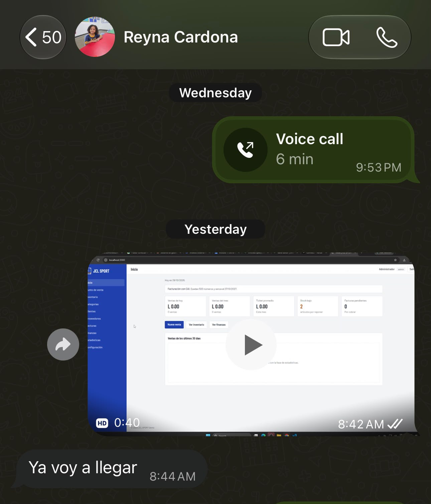

# Visión del proyecto

## 1. Resumen

Andeliza ERP es un sistema de gestión administrativo para pymes hondureñas. Reúne ventas, inventario, clientes, proveedores, finanzas y facturación con CAI del SAR, o facturación interna para negocios que todavía no están registrados. Todo funciona desde el navegador, sin instalar nada y sin servidor propio, y no exige conocimientos técnicos al usuario.

La propuesta de valor es que una pyme pueda tener un sistema contable y de ventas profesional sin comprar infraestructura de red ni servidores físicos. El procesamiento y los datos viven en la nube. El usuario entra a la URL y empieza a trabajar. Esa independencia de la infraestructura del usuario es la idea central del proyecto.

Stack: Node con Express y EJS, PostgreSQL en Supabase y Vercel con HTTPS público.

## 2. Antecedentes y evidencia de conversaciones

### Antecedentes

El proyecto parte de la necesidad real de digitalizar la operación de pymes locales. Para validar las decisiones de diseño, se sostuvieron conversaciones directas con dos negocios fundacionales, abarcando sus distintos niveles de madurez (una que no está inscrita en el SAR y otra que acaba de registrarse), además de la asesoría académica para enfocar la solución como un SaaS/ERP.

### Registro de conversaciones

| # | Con quién | Fecha y medio | Qué se habló | Qué se aprendió | Evidencia |
|---|---|---|---|---|---|
| 1 | Ingeniero asesor del proyecto | Domingo 25 (Presencial) y Miércoles 28 (Mensaje) | Presentación del planteamiento inicial y ajuste del enfoque hacia un SaaS/ERP en la nube para pymes. | Se definió la arquitectura serverless (Vercel + Supabase) como el diferenciador clave para evitar costos de infraestructura a los clientes. | Asesoría académica |
| 2 | Reyna Cardona (Representante de JCL Sport) | 28 y 29 de Octubre (Llamadas y WhatsApp) | Cómo vende y lleva su stock actualmente. Necesidades de facturación (no están en el SAR). | JCL Sport requiere variantes por talla y edición. Al ser Reyna contadora, exigió que el módulo de finanzas implementara **partida doble (Debe/Haber)** real para cuadrar sus libros. Como no tienen SAR, requieren facturación interna. |  |
| 3 | Ana Girón (Representante de Las Flores) | 28 y 29 de Octubre (Llamadas y WhatsApp) | Cómo maneja su floristería que acaba de empezar. Recién se afiliaron al SAR y necesitan un sistema fácil de usar. | Al estar comenzando, valoran muchísimo la facilidad de uso y el "cero mantenimiento". Al tener SAR activo, necesitan que el sistema les controle el CAI y la fecha límite automáticamente. |  |

**Guion utilizado para las conversaciones con dueños de pymes:**

1. ¿Cómo registra hoy sus ventas y su inventario?
2. ¿Cómo sabe cuánto le deben sus clientes y cuánto debe a sus proveedores?
3. ¿Está inscrito en el SAR? ¿Cómo emite sus facturas o comprobantes?
4. ¿Cuál fue la última vez que el inventario no coincidió con lo que había en bodega y qué pasó?
5. ¿Con qué dispositivos trabaja y qué tan estable es su internet durante la jornada?
6. Si pudiera cambiar una sola cosa de cómo lleva su negocio, ¿qué sería?

## 3. Problema y usuarios

Las pymes hondureñas suelen llevar su operación en registros manuales y herramientas que no están conectadas. Eso produce cuatro dolores:

1. **No saben su situación real.** La utilidad, lo que les deben y lo que deben se calculan tarde o no se calculan.
2. **El inventario se desajusta.** El stock registrado no coincide con el físico y no hay costo confiable por producto.
3. **La facturación es una carga.** Quien está inscrito debe cuidar el CAI, el rango autorizado y la fecha límite. Quien no lo está necesita igual un comprobante ordenado.
4. **La barrera técnica es alta.** Equipos, red, servidor, instalación y soporte cuestan más de lo que el negocio puede asumir.

### Usuarios

| Rol | Quién es | Qué necesita |
|---|---|---|
| Administrador | Dueña o dueño del negocio (ej. Reyna, Ana) | Ver ventas, inventario, deudas y utilidad. Configurar el negocio y controlar el dinero. Poca disponibilidad técnica. |
| Vendedor | Quien atiende el mostrador | Buscar productos, cobrar rápido, emitir la factura y atender al cliente. No necesita ver las finanzas. |

## 4. Lean Canvas

| Bloque | Contenido |
|---|---|
| **Problema** | 1. No conocen su situación real: utilidad, deudas por cobrar y por pagar. 2. Inventario y facturación se llevan a mano y se desajustan. 3. Un sistema formal exige infraestructura y soporte técnico que no pueden pagar. |
| **Alternativas actuales** | Cuadernos, hojas sueltas y registros manuales del negocio. |
| **Segmentos de clientes** | Pymes hondureñas de comercio y servicios con uno a diez usuarios, inscritas o no en el SAR. Primeros clientes: JCL Sport (ropa deportiva) y Las Flores (floristería). |
| **Propuesta de valor única** | Un sistema contable y de ventas profesional que se usa desde el navegador: entras a la URL y empiezas a trabajar. Sin servidores, sin instalación, con facturación SAR o interna. |
| **Solución** | Punto de venta con variantes y kits. Inventario. Clientes y proveedores. Facturación con CAI o interna, con PDF. Cuentas por cobrar y por pagar. Contabilidad por partida doble y reportes. |
| **Canales** | Demostración presencial en el negocio. Recomendación entre dueños de pymes. Contadores locales. Redes sociales. *(Hipótesis por validar.)* |
| **Fuentes de ingreso** | Suscripción mensual por negocio y cobro único de configuración e implementación. *(Modelo por validar: aún no hay precios definidos.)* |
| **Estructura de costos** | Alojamiento en Vercel, base de datos y almacenamiento en Supabase, dominio, y tiempo de implementación, capacitación y soporte. |
| **Métricas clave** | Tiempo desde el registro hasta la primera venta. Ventas registradas por semana. Facturas emitidas sin error. Negocios activos al mes. Consultas de soporte por negocio. |
| **Ventaja diferenciadora** | Doble modo de facturación en un mismo sistema. Contabilidad integrada al punto de venta, sin pasos extra. Plantilla que se adapta a cada negocio con un solo archivo de configuración. Diseñado para el contexto fiscal hondureño. |

## 5. Tres hipótesis riesgosas

Son las suposiciones que, si resultan falsas, harían inviable el proyecto. Cada una se asocia a un experimento barato y a un criterio de éxito antes de ejecutarlo.

| # | Hipótesis | Por qué es riesgosa | Experimento | Criterio de éxito |
|---|---|---|---|---|
| H1 | Un dueño o vendedor sin capacitación puede registrar una venta con factura en menos de dos minutos. | Toda la propuesta de valor depende de que no se necesite conocimiento técnico. | Prueba de uso con las representantes de JCL Sport y Las Flores, pidiéndoles cobrar una venta sin explicarles nada. | Completar la venta sin ayuda y en menos de dos minutos. |
| H2 | El negocio tiene conexión a internet suficiente durante toda la jornada para trabajar solo en la nube. | Si falta conexión, no se puede vender: el sistema no tiene modo sin conexión. | Preguntar por la estabilidad del internet en cada conversación y medir la latencia desde los negocios. | Interrupciones menores a cinco minutos por semana y tiempos de respuesta aceptables en el punto de venta. |
| H3 | La factura y los reportes que emite el sistema son aceptables para el negocio y para su contador. | Si el formato no cumple lo que se necesita, la contabilidad pierde sentido. | Revisión del módulo de finanzas con Reyna Cardona (quien es contadora). | La contadora confirma que la partida doble (Debe/Haber) y los datos de las facturas cumplen con lo que necesita para cuadrar los libros de su negocio. |

### Estado actual de la evidencia

- **H1:** Parcialmente validada. Las conversaciones confirmaron que Ana (de Las Flores) busca facilidad de uso por ser un negocio nuevo. Falta la prueba cronometrada formal.
- **H2:** En evaluación. Ambas clientas trabajan de forma presencial, pero se debe confirmar la calidad de su conexión a internet en horas pico.
- **H3:** Fuertemente validada. Reyna Cardona (contadora de JCL Sport) fue clave para el diseño del motor contable (Fase 4), validando que el sistema generara asientos reales con partidas dobles y reportes de Balance General y Estado de Resultados.

## 6. Alcance

### Dentro del alcance

- Inicio de sesión con dos roles: administrador y vendedor.
- Catálogo e inventario: categorías, productos con imagen, variantes con stock propio, kits y unidades.
- Clientes y proveedores, con RTN opcional.
- Punto de venta: búsqueda, carrito, cobro, cotización y vendedor con acceso limitado.
- Facturación dual: factura con CAI del SAR o comprobante interno, con PDF y historial.
- Cuentas por cobrar y por pagar con abonos y pagos parciales y antigüedad de saldos.
- Ingresos, gastos y compras con condición de pago.
- Contabilidad por partida doble: libro diario, balanza y reportes en PDF (estado de resultados, flujo de caja, balance general y antigüedad de saldos).
- Alertas de stock y vista visual del inventario.
- Estadísticas de ventas.
- Configuración del negocio y de los usuarios desde la interfaz, con contraseñas protegidas.
- Acceso desde el celular con QR.
- Despliegue en la nube con HTTPS público y documentación.

### Fuera del alcance (por ahora)

- Métodos de pago diferenciados (efectivo, tarjeta, transferencia). Hoy el cobro entra a Caja.
- Devoluciones, ventas anuladas y notas de crédito.
- Crédito fiscal sobre las compras.
- Cierre de períodos contables.
- Modo sin conexión.

### Fuera del alcance (definitivo en este proyecto)

- Multi-tenant: cada negocio tiene su propia instancia.
- Envío o certificación electrónica de facturas ante el SAR.
- Aplicación móvil nativa.
- Varias sucursales o bodegas y varias monedas.
- Planillas y nómina.
- Conciliación bancaria y pasarelas de pago.

## 7. Criterios de éxito del proyecto

1. Negocios reales (JCL Sport y Las Flores) usan el sistema en producción para vender y facturar.
2. El flujo vender, facturar, cobrar y ver el resultado en finanzas funciona de punta a punta sin intervención técnica.
3. Los reportes contables cuadran: Activo = Pasivo + Patrimonio y las cuentas por cobrar y por pagar coinciden con el detalle de documentos (validado por una contadora).
4. Las tres hipótesis tienen evidencia, a favor o en contra, antes de la entrega final.
5. Cualquier persona puede instalar el proyecto desde cero siguiendo el README.